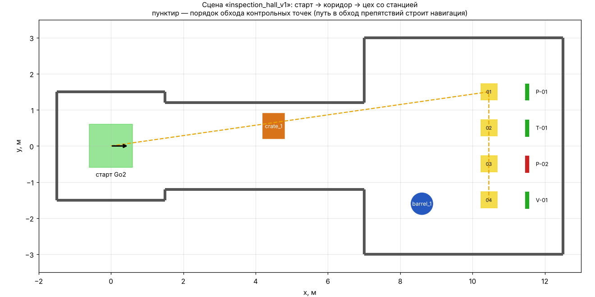

# Симуляционный прототип инспекционного робота Unitree Go2 EDU

Проектный практикум, УрФУ ИРИТ-РТФ.
Авторы: **Четин Хюсейн Озгюр**, **Гюзель Алпер**.

Четвероногий робот Unitree Go2 в Gazebo **автономно, через Nav2** проходит маршрут по
производственному помещению: стартовая зона → коридор с препятствием → цех со стойкой
стрелочных приборов. У каждого прибора робот точно встаёт напротив, 2–3 с смотрит на него
камерой (кадр сохраняется), боком переходит к следующему, затем возвращается на старт и
формирует отчёт «посещено / не доехал». Оператор ничего не делает руками.



## Стек

| Компонент | Версия / решение |
|---|---|
| ОС | Ubuntu 24.04 (WSL2 на Windows 11) |
| Middleware | ROS 2 Jazzy |
| Симулятор | Gazebo Sim 8 (Harmonic) |
| Модель робота | Unitree Go2 — [khaledgabr77/unitree_go2_ros2](https://github.com/khaledgabr77/unitree_go2_ros2), контроллер ходьбы CHAMP |
| Навигация | Nav2: map_server, NavFn, Regulated Pure Pursuit, behavior server, BT navigator |
| Миссия | собственный узел `route_runner` (nav2_simple_commander) |

## Структура репозитория

```
inspector_world/          ROS 2-пакет: сцена, карта, Nav2, миссия (подробно — inspector_world/README.md)
  config/scene.yaml       описание сцены: помещения, препятствия, станции, приборы
  scripts/                генератор мира, карты, текстур и маршрута из scene.yaml
  launch/                 inspection_mission (всё сразу), inspection_world, navigation
  tools/                  route_runner (миссия), gt_localizer (локализация), stop_all.sh
docs/SETUP.md             установка окружения с нуля (WSL, ROS 2, Gazebo, Go2, ускорение графики)
tools/wasd_teleop.py      ручное управление с клавиатуры (для отладки)
deployment/factory_integration/  установщик, две final-модели и инструкция для второго ПК
INSTALL_ON_FRIEND_PC.cmd  полная установка в WSL Ubuntu 24.04
START_SIMULATION.cmd      запуск всей миссии одним двойным щелчком
```

## Быстрый старт

Окружение (Ubuntu 24.04, ROS 2 Jazzy, Gazebo Harmonic, пакет Go2) — по [docs/SETUP.md](docs/SETUP.md). Затем:

```bash
sudo apt install -y ros-jazzy-navigation2
cd ~/ros2_ws/src
git clone https://github.com/GuzelAlper/virtual-robot-inspector.git
cd ~/ros2_ws && colcon build --packages-select inspector_world && source install/setup.bash

ros2 run inspector_world stop_all.sh                    # убрать остатки прошлых запусков
ros2 launch inspector_world inspection_mission.launch.py software_render:=true
```

Через ~30 с Go2 встаёт, через ~40 с стартует Nav2 и миссия. Откроются окна Gazebo и камеры
робота. Ход миссии — в терминале (`[1/4] еду к CP-01 …`, `встал напротив прибора …`),
отчёт — в `~/inspection_reports/<дата_время>/report.md`.

## Текущее состояние

* [x] окружение ROS 2 + Gazebo, модель Go2, ручное управление
* [x] сцена: помещения, препятствия, станция с 4 стрелочными приборами (генерируется из YAML)
* [x] карта для Nav2 из той же сцены, локализация в симуляции
* [x] автономный обход маршрута через Nav2, точная постановка напротив приборов, возврат на старт
* [x] отчёт по миссии (Markdown / JSON / CSV + кадры камеры), обработка «не доехал / застрял / упал»
* [x] распознавание показаний четырёх стрелочных приборов (локатор + reader)
* [ ] 16 станций × 4 прибора по ТЗ (добавляются в `scene.yaml`)
* [x] базовая SQLite-схема результатов инспекции (`inspection_db.py`)
* [x] автоматический отчёт из SQLite (Markdown / CSV / JSON)
* [x] автономный запуск locator + reader на одном сохранённом кадре
* [ ] классификация четырёх типов приборов по изображению
* [x] запись реальной миссии и измерений в SQLite; отчёт со значением, OK/ALARM и AI-кадром
* [ ] пульт оператора

## База данных результатов

База данных хранит миссии, станции, приборы, измерения, изображения, события и
ошибки. Она не требует внешнего сервера и использует SQLite из стандартной
библиотеки Python.

```bash
ros2 run inspector_world inspection_db.py init --db ~/inspection_data/inspection.db
ros2 run inspector_world inspection_db.py demo --db ~/inspection_data/inspection.db
ros2 run inspector_world inspection_db.py show --db ~/inspection_data/inspection.db
```

## Автоматический отчёт

Генератор берёт выбранную миссию из SQLite и создаёт `report.md`,
`measurements.csv` и `mission.json`. Если `--mission` не указан, используется
последняя миссия в базе.

```bash
ros2 run inspector_world inspection_report.py \
  --db ~/inspection_data/inspection.db \
  --out ~/inspection_reports/latest
```

## Распознавание одного кадра

Текущая версия находит один целевой прибор и считывает его показание. До
добавления классификатора тип прибора передаётся параметром `--instrument`.

```bash
python3 inspector_world/tools/gauge_inference.py \
  --image /path/to/frame.png \
  --instrument T-01 \
  --locator /path/to/best_gauge_locator.pt \
  --reader /path/to/best_gauge_distribution_reader.pt \
  --json-out results/reading.json \
  --annotated-out results/reading.png
```

## Просмотр распознавания в ROS 2

Узел ждёт состояния `AT_INSTRUMENT`, берёт следующий кадр `/rgb_image`,
публикует результат в `/inspection/gauge_result`, а изображение с рамкой — в
`/inspection/annotated_image`.

```bash
ros2 run inspector_world gauge_reader_node.py \
  --locator /path/to/best_gauge_locator.pt \
  --reader /path/to/best_gauge_distribution_reader.pt

ros2 run rqt_image_view rqt_image_view /inspection/annotated_image
ros2 topic echo /inspection/gauge_result
```
