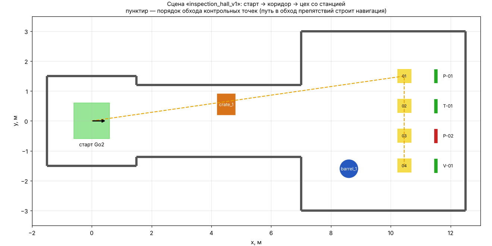

# inspector_world — сцена инспекции и автономный обход для Unitree Go2

ROS 2-пакет для симуляции «робот-инспектор»: Go2 **сам, через Nav2** проходит по
помещению, по очереди подходит к каждому стрелочному прибору на стойке, стоит перед
ним 2–3 с (камера смотрит на прибор, кадр сохраняется), идёт к следующему, возвращается
на старт и формирует отчёт «посещено / не доехал». Оператор ничего не делает руками.

Показания приборов в этой версии не считываются (распознавание будет добавлено отдельно).

Работает поверх окружения из `docs/SETUP.md` общего репозитория:
Ubuntu 24.04, ROS 2 Jazzy, Gazebo Harmonic, пакет Go2 `khaledgabr77/unitree_go2_ros2`.



## Что внутри

| Путь | Назначение |
|---|---|
| `config/scene.yaml` | **Описание сцены** — помещения, препятствия, станции и приборы. Правится вручную |
| `scripts/generate_world.py` | Генератор: из `scene.yaml` делает мир, карту, текстуры приборов, маршрут и схему |
| `worlds/inspection_hall.sdf` | Мир Gazebo (сгенерирован) |
| `maps/inspection_hall.{pgm,yaml}` | Карта занятости для Nav2 (сгенерирована из той же сцены) |
| `config/route.yaml` | Маршрут: контрольная точка перед каждым прибором (сгенерирован) |
| `config/nav2_params.yaml` | Настройки Nav2: NavFn (A*), Regulated Pure Pursuit, costmap |
| `launch/inspection_mission.launch.py` | **Вся миссия одной командой** |
| `launch/inspection_world.launch.py` | Только симуляция: Go2 в сцене + локализация |
| `launch/navigation.launch.py` | Только Nav2 |
| `tools/route_runner.py` | Менеджер миссии: обход точек через Nav2, кадры у приборов, отчёт |
| `tools/gt_localizer.py` | Локализация в симуляции (TF world → map по истинной позе Gazebo) |
| `tools/stop_all.sh` | Остановить всё, что осталось от прошлых запусков |
| `tools/gauge_lib.py` | Рисование табличек приборов (используется генератором) |

## Сцена

Стартовая зона (зелёная) → коридор 2.4 м с ящиком-препятствием → цех 5.5 × 6 м с бочкой
и станцией **ST-01**: стойка с трубопроводом и четырьмя стрелочными приборами
(P-01 манометр, T-01 термометр, P-02 манометр, V-01 вакуумметр).
Перед каждым прибором на полу жёлтая площадка — контрольная точка (1.05 м от прибора).

## Как устроена навигация

```
world ──(gt_localizer)──► map ──(статично)──► odom ──(EKF CHAMP)──► base_footprint ──► base_link
  ▲ карта Nav2, цели маршрута, мир Gazebo
```

* **Карта** генерируется из `scene.yaml` вместе с миром — стены, препятствия и стойки
  всегда совпадают с тем, что в Gazebo.
* **Локализация**: одометрия шагающего робота «плывёт», поэтому `gt_localizer` по
  `/odom/ground_truth` держит кадр `world → map` так, чтобы положение робота на карте
  было точным. На реальном Go2 вместо него ставится AMCL/SLAM — остальное не меняется.
* **Nav2**: map_server, planner_server (NavFn A*), controller_server (Regulated Pure
  Pursuit, до 0.45 м/с), behavior_server (spin/backup/wait),
  bt_navigator. Команды идут в `/cmd_vel` → контроллер ходьбы CHAMP.
* **Препятствия**: известные — на карте; новые — через лидар (`lidar:=true`).
* **Миссия** (`route_runner`): Nav2 (`NavigateToPose`) подводит робота к стойке → точная
  постановка строго напротив прибора (Go2 голономный: сдвиг вперёд/вбок и поворот одновременно,
  по истинной позе, допуск 6 см / 3.5°) → `dwell` с смотрит на прибор, кадр → к соседнему
  прибору на той же стойке — боком, не разворачиваясь. Не доехал — точка помечается, миссия продолжается.
  В конце возврат на старт и отчёт.

## Установка

```bash
sudo apt install -y ros-jazzy-navigation2            # Nav2, один раз
# поднять пределы скорости контроллера ходьбы CHAMP (по умолчанию 0.3 м/с и 0.5 рад/с):
sed -i 's/max_linear_velocity_x : 0.3/max_linear_velocity_x : 0.5/; s/max_angular_velocity_z : 0.5/max_angular_velocity_z : 0.8/' \
  ~/ros2_ws/src/unitree_go2_ros2/unitree_go2_sim/config/gait/gait.yaml
(cd ~/ros2_ws && colcon build --packages-select unitree_go2_sim)
cd ~/ros2_ws/src
# скопировать сюда папку inspector_world (или git clone общего репозитория)
cd ~/ros2_ws                                         # сборка — из корня рабочего пространства!
colcon build --packages-select inspector_world
source install/setup.bash
```

## Запуск миссии

```bash
ros2 run inspector_world stop_all.sh                 # убрать остатки прошлых запусков
ros2 launch inspector_world inspection_mission.launch.py software_render:=true
# варианты: dwell:=3 (секунд у прибора), lidar:=true (видеть новые препятствия), rviz:=true,
#           camera_view:=false (не открывать окно камеры робота)
```

Что происходит:

1. 0–30 с — Gazebo, Go2 падает на пол и встаёт, когда активируются контроллеры CHAMP;
2. ~40 с — стартует Nav2, затем миссия: `[1/4] еду к CP-01 …`;
3. у каждого прибора: `✓ на месте, смотрю на прибор 2.5 с`;
4. возврат на старт и `ИТОГ: COMPLETED`, путь к отчёту.

Результаты: `~/inspection_reports/<дата_время>/` — `report.md` (навигация,
показание прибора, OK/ALARM, уверенность модели, обычный и AI-кадр),
`results.json`, `results.csv`, кадры камеры у каждого прибора.
Топик состояния: `/inspection/mission_state`.

## Изменение сцены

Правим `config/scene.yaml` (новые станции — по ТЗ до 16 станций × 4 прибора), затем:

```bash
cd ~/ros2_ws/src/inspector_world
python3 scripts/generate_world.py
cd ~/ros2_ws && colcon build --packages-select inspector_world
```

## Частые проблемы

| Симптом | Причина / решение |
|---|---|
| Робот крутится на месте, в логе `no map received` / `Costmap timed out` | Остались старые узлы Nav2 — `stop_all.sh` и запуск заново |
| `Detected jump back in time`, робот падает | Работают два Gazebo — `stop_all.sh` |
| Кадры камеры чёрные | В WSL камера-сенсор с GPU-рендером (d3d12) может давать чёрный кадр → `software_render:=true` |
| `Package 'inspector_world' not found` | Сборка не из `~/ros2_ws` или не выполнен `source ~/ros2_ws/install/setup.bash` |

## Следующие шаги

* распознавание показаний приборов (нейросеть);
* AMCL вместо локализации по истинной позе (ближе к реальному роботу);
* запись результатов в базу данных и пульт оператора.
